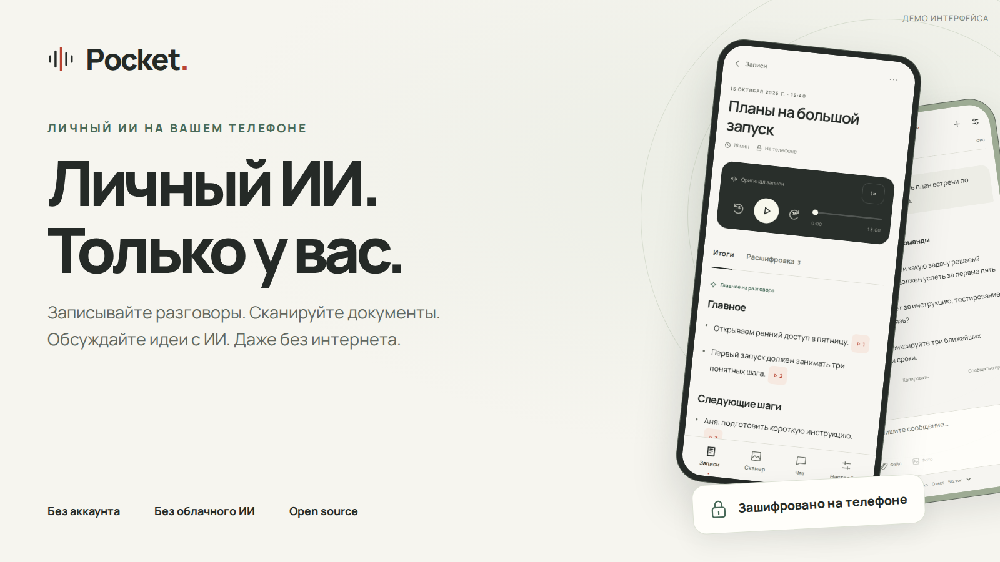
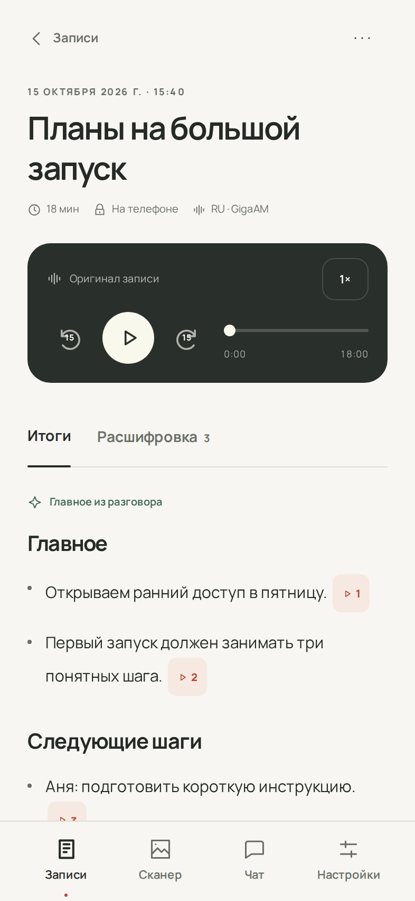
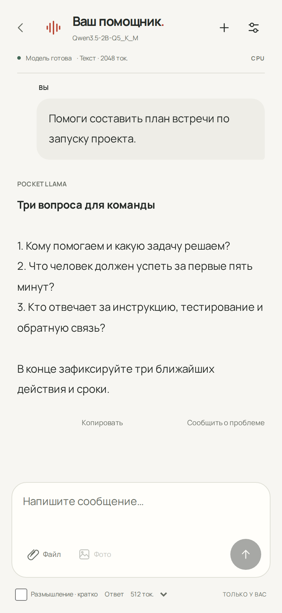
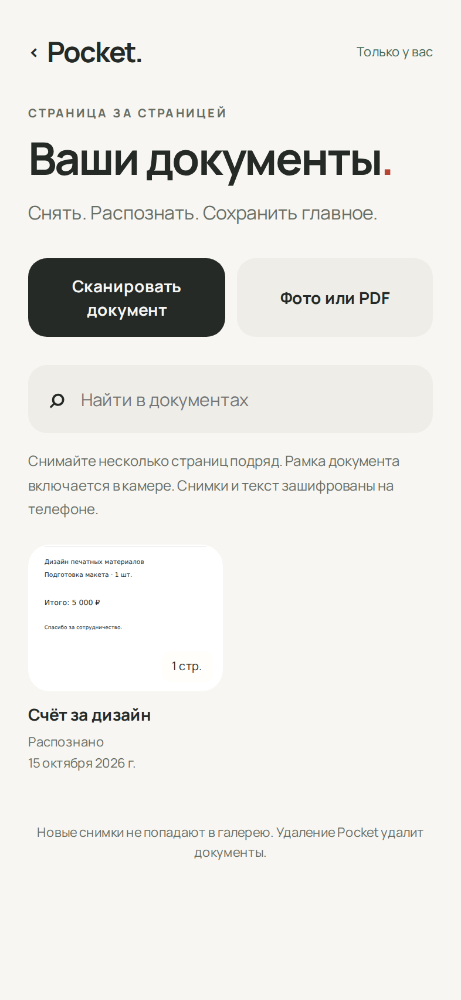

<a href="README.md">English</a> · <b>Русский</b>

<h1 align="center">Pocket — локальный ИИ для Android</h1>

Распознавание речи, конспекты встреч, личные заметки, OCR документов и локальный ИИ-чат. <b>Вся обработка ИИ происходит на вашем телефоне.</b>

<a href="https://github.com/RadmirAmir/pocket-llama/releases/download/v0.11.0-rc.3/PocketLlama-0.11.0-community-arm64.apk"><b>↓ Скачать для Android</b></a> · <a href="docs/GETTING-STARTED-RU.md">Как пользоваться</a> · <a href="docs/SECURITY-RU.md">Приватность и защита</a>

Android 10+ · ARM64 · Открытый код · Без регистрации · Без рекламы

Pocket пригодился? <b>Поддержите проект звездой на GitHub.</b>

Pocket — бесплатное Android-приложение с открытым кодом для распознавания речи без интернета, расшифровки и конспектов встреч, ведения заметок с поиском, сканирования документов с OCR и локального ИИ-чата на базе llama.cpp. Записывайте встречи, лекции и голосовые заметки на русском или английском, распознавайте текст фотографий и PDF и сохраняйте личные данные в зашифрованном хранилище на телефоне.

**Сразу после установки доступны:** заметки, диктофон, расшифровка русской/английской речи и OCR. **Для чата и конспектов:** один раз скачайте или импортируйте совместимую языковую модель в формате GGUF, затем используйте её без интернета.

**Сейчас доступна публичная предварительная версия 0.11.0-rc.3:** APK размером около 641 МБ. Публикация в Google Play готовится. В настройках есть **EN / RU**. Для английской речи используется **Moonshine Streaming Medium**, для русской — **GigaAM v3**. Обе речевые модели и OCR русского/английского текста уже встроены. **Дополнительная Surya OCR 2:** текст, разметка и таблицы локально; модели загружаются один раз — 1,47 ГБ, после принятия условий.

## Распознавание речи и конспекты встреч без интернета

Записывайте встречи, лекции и голосовые заметки. Pocket превращает русскую и английскую речь в текст с поиском и временными метками, разделяет спикеров и помогает собрать короткий конспект. У выводов есть ссылки на исходные реплики: нажмите и послушайте, что было сказано.

**Две модели уже внутри:** GigaAM v3 для русского и Moonshine Streaming Medium для английского. Для диктофона и расшифровки не нужно отдельно скачивать речевую модель. Для конспектов используется выбранная вами локальная языковая модель.

**Встроенный интернет-поиск:** в инструментах чата можно включить SearXNG, который запускается внутри приложения. После предупреждения текущий вопрос уходит в Google, Brave и DuckDuckGo; под ответом появляются источники. История, вложения и база знаний не отправляются. В новом диалоге поиск выключен. [Подробнее →](docs/SEARCH.md)

## Личные заметки, которые легко найти

Записывайте идеи, планы и списки дел. Заметки сохраняются автоматически, зашифрованы на телефоне и работают без модели и интернета. Ищите по заголовкам и всему тексту, закрепляйте важное, восстанавливайте случайно удалённое из корзины. Интерфейс поддерживает русский и английский; ваш текст остаётся без изменений. [Как пользоваться заметками →](docs/NOTES.md#русский)

## Локальный ИИ-чат с моделями GGUF

Обдумайте идею, подготовьте письмо или попросите объяснить сложную тему. Во встроенном каталоге есть небольшие модели: Pocket покажет размер, проверит память телефона и предложит подходящий вариант. Загрузку можно поставить на паузу и продолжить; целостность файла проверяется автоматически. Свой совместимый GGUF тоже можно импортировать.

**Без облачного ИИ и создания аккаунта.** Переписка хранится в зашифрованном хранилище приложения.

## Сканер документов и OCR без интернета

Снимите чек, страницу конспекта или документ. Поправьте рамку и перспективу, распознайте текст и находите его поиском. Добавляйте несколько страниц, импортируйте фотографии и PDF, исправляйте результат и сохраняйте PDF с текстовым слоем.

**PaddleOCR уже внутри.** Русский и английский текст распознаётся на телефоне сразу после установки.

<table>
  <tr><th>Записи</th><th>Чат</th><th>Сканер</th></tr>
  <tr>
    <td width="33%"></td>
    <td width="33%"></td>
    <td width="33%"></td>
  </tr>
</table>

Настоящие веб-интерфейсы приложения с демонстрационным содержимым. Ответ и конспект показаны для знакомства с интерфейсом, а не как тест качества модели. Системные экраны Android не показаны.

## Приватность и зашифрованное хранилище

| Что защищаем | Как это устроено |
| --- | --- |
| Записи, сканы и переписка | Обрабатываются на телефоне; автоматической отправки личного содержимого нет |
| Сохранённые данные | Зашифрованное хранилище: файлы AES-256-GCM и базы расшифровок, заметок и поискового индекса SQLCipher |
| Ключи шифрования | Управляются через Android Keystore; аппаратная защита зависит от устройства |
| Доступ | Шестизначный PIN, блокировка при уходе приложения в фон, защита от захвата экрана средствами Android |
| Слежение | Нет рекламных SDK, автоматической аналитики и автоматической отправки отчётов о сбоях |
| Резервные копии | Системный бэкап приложения отключён; облачного аккаунта и восстановления PIN нет |

**Локальный ИИ не означает полный запрет сети.** Сеть нужна для выбранных вами загрузок моделей, импорта видео по ссылке и открытия внешних страниц. Экспорт передаёт файл в выбранное вами место. Дополнительный API модели для локальной сети по умолчанию выключен. Код поддерживает добровольные обращения с предварительным просмотром текста; сервер обращений в этом публичном preview не настроен. Всё хранилище автоматически к обращению не прикладывается. [Подробнее о защите и сети →](docs/SECURITY-RU.md)

## Скачать и начать пользоваться

1. **[Скачайте APK](https://github.com/RadmirAmir/pocket-llama/releases/download/v0.11.0-rc.3/PocketLlama-0.11.0-community-arm64.apk)** на телефон с Android 10+ и ARM64. Разрешите установку из браузера, когда Android предложит.
2. **Придумайте шестизначный PIN.** Диктофон, расшифровка EN/RU и OCR уже готовы. В **«Настройки» → «Язык интерфейса»** выберите EN или RU — этот же язык будет у новых расшифровок.
3. **Откройте «Настройки» → каталог моделей.** Начните с рекомендованной модели, скачайте её и нажмите **«Использовать»**. Теперь доступны локальные чат и конспекты.
4. **Попробуйте своё:** создайте заметку, запишите мысль, отсканируйте страницу или откройте «Чат». После подготовки проверьте основные функции в авиарежиме.

[Подробная инструкция и решение частых проблем →](docs/GETTING-STARTED-RU.md)

## Совместимость с Android и требования к памяти

Публичная сборка предназначена для **Android 10 и новее с 64-битной ARM-системой**. Используется переносимый CPU-движок: специальный NPU не требуется. Snapdragon, MediaTek, Exynos и Tensor — целевые семейства процессоров, а не список телефонов, уже прошедших физические испытания.

| Ориентир для начала¹ | Модель чата | Загрузка | Желательно свободного места² |
| --- | --- | --- | --- |
| Телефон с 6 ГБ ОЗУ | Qwen 3.5 · 0.8B · Q5_K_M | 646 МБ | 6 ГБ |
| Телефон с 8 ГБ ОЗУ | Qwen 3.5 · 2B · Q5_K_M | 1,57 ГБ | 6 ГБ |
| Телефон с 12 ГБ ОЗУ | Qwen 3.5 · 4B · Q4_K_M | 3,01 ГБ | 8 ГБ |

¹ Это ориентиры для выбора, а не замеры скорости на телефонах. Pocket проверяет фактически доступную Android память, свободную ОЗУ и место. Число на коробке может отличаться от памяти, которую видит система. Маленькую модель запустить проще; скорость и нагрев зависят от телефона.

² Запас для установки и одной модели, до ваших записей и документов. Для личных данных понадобится дополнительное место. [Точные ограничения каталога и поддержка платформ →](docs/COMPATIBILITY.md#русский)

**Доступно:** Android ARM64, предварительная версия. **Пока нет релизов:** iOS, Windows, macOS, Linux, Android x86 и 32-битный Android.

## Частые вопросы перед установкой

**Без интернета правда работает?** Да. Диктофон, расшифровка EN/RU и OCR используют встроенные модели. Для чата и конспектов один раз скачайте или импортируйте совместимую LLM.

**А Google Play?** APK уже можно скачать здесь. AAB и сборочный процесс подготовлены; публикация в магазине и проверка на телефонах ещё впереди.

**ИИ может ошибаться?** Да. Важные имена, суммы и выводы проверяйте по оригиналу. Разделение спикеров приблизительное. Иллюстрации выше показывают интерфейс, а не гарантированное качество ответа.

**Если забуду PIN?** Облачного восстановления нет. Заранее экспортируйте важное, пока доступ открыт. Удаление приложения или очистка его данных лишает доступа к хранилищу. Экспортированные файлы уже не защищены шифрованием Pocket.

**У меня уже есть личная сборка.** Публичный preview устанавливается отдельно. Сохраните прежнее приложение: автоматического переноса хранилища между пакетами нет. [Подробнее об обновлениях →](docs/GETTING-STARTED-RU.md#обновления-и-прежняя-установка)

## Сборка из исходников и участие в разработке

Собственный код Pocket распространяется по **Apache-2.0**. Для речи используются GigaAM v3 (RU), Moonshine Streaming Medium (EN), Silero VAD и CAM++; в сканере — PaddleOCR и дополнительная Surya OCR 2; чат работает через llama.cpp. У зависимостей и весов моделей свои лицензии. Отдельный детектор строк под CC BY-NC-SA удалён. Для моделей Surya и результатов OCR действуют их собственные условия. Приложение бесплатное, без рекламы и платных функций. [Лицензии и состав →](docs/LICENSING.md)

[Собрать из исходников](docs/BUILDING.md) · [Участвовать](CONTRIBUTING.md) · [Подготовка релиза](docs/RELEASE.md) · [Что проверено](docs/VALIDATION-0.11.0.md) · [Сообщить об ошибке](https://github.com/RadmirAmir/pocket-llama/issues/new/choose)

Если вам тоже нужен полезный ИИ, который остаётся на вашем телефоне, **поставьте Pocket звезду** и помогите сделать следующий релиз лучше. Для сообщения об ошибке пригодятся модель телефона, версия Android, выбранная LLM и шаги воспроизведения. Личные записи, документы и переписку в публичные issues не прикладывайте.

## Личная база знаний в чате

Включите **Инструменты → Личная база знаний**: помощник найдёт договорённость в расшифровке, сумму на скане или мысль в заметках и покажет источники. Модель EmbeddingGemma Q8 скачивается отдельно — около 329 МБ. Поиск работает на телефоне, индекс зашифрован, инструмент включается явно для текущего диалога. [Настройка и подробности →](docs/RAG.md#русский)
