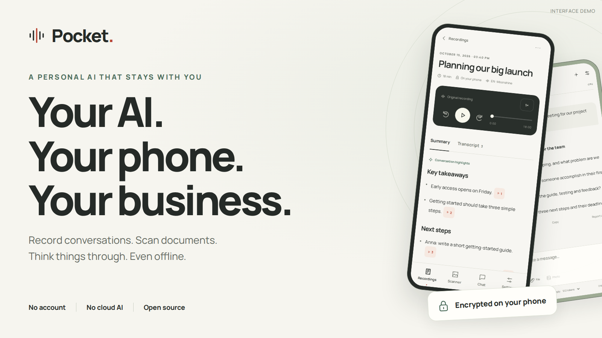
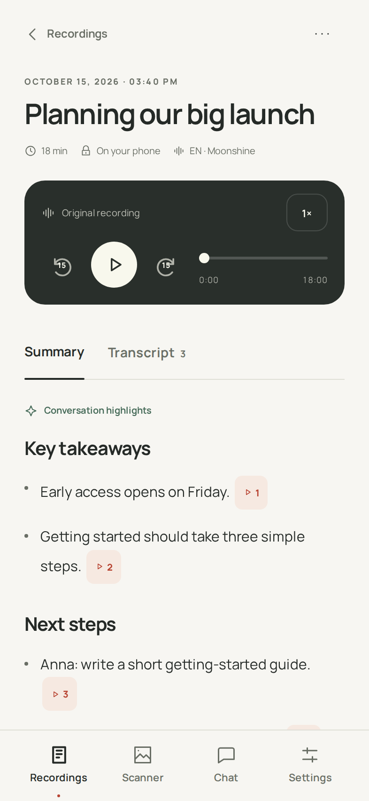
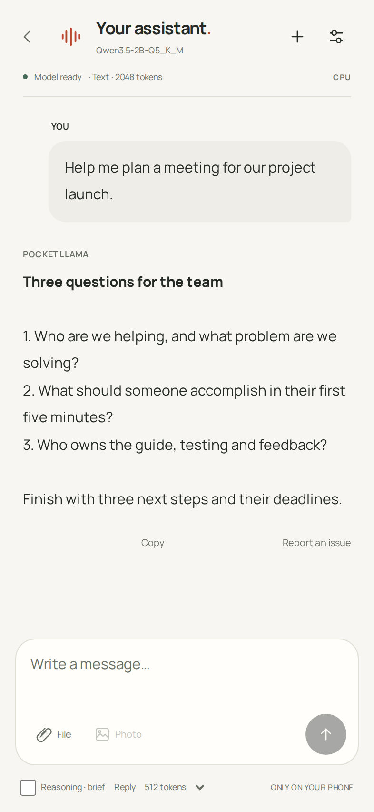
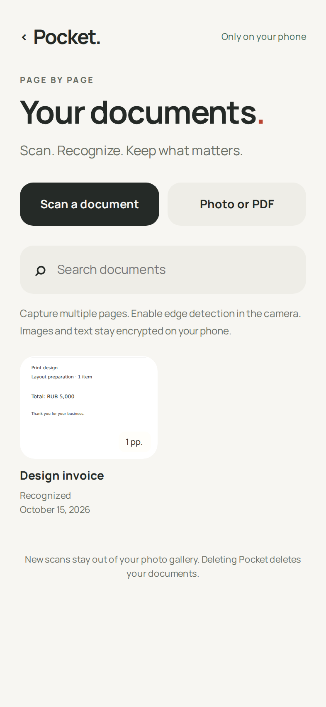

<b>English</b> · <a href="README-RU.md">Русский</a>

<h1 align="center">Pocket — Offline AI for Android</h1>

Speech-to-text, meeting summaries, private notes, document OCR and local LLM chat. <b>All AI processing happens on your Android phone.</b>

<a href="https://github.com/RadmirAmir/pocket-llama/releases/download/v0.13.3-rc.1/PocketLlama-0.13.3-community-arm64.apk"><b>↓ Download for Android</b></a> · <a href="docs/GETTING-STARTED.md">Get started</a> · <a href="docs/SECURITY.md">Privacy & security</a>

Android 10+ · ARM64 · Open source · No account · No ads

Find Pocket useful? <b>Support the project with a star on GitHub.</b>

Pocket is a free, open-source Android app for offline speech recognition (speech-to-text), meeting transcription and summaries, encrypted searchable notes, document scanning with OCR, and local LLM chat powered by llama.cpp. Record meetings, lectures or voice notes in English or Russian, recognize text from photos and PDFs, and keep your saved content in an encrypted vault on your phone.

**Ready after installation:** notes, recording, English/Russian transcription and OCR. **For chat and summaries:** download or import a compatible GGUF language model once, then use it offline.

**Public preview: 0.13.3-rc.1.** Available here as an APK, approximately 662 MB. Google Play release is being prepared. Switch between **English and Russian in Settings**. English speech uses **Moonshine Streaming Medium**; Russian uses **GigaAM v3**. Both speech models and Russian/English OCR are included. **Optional Surya OCR 2:** optional local text, layout and table recognition, with a one-time 1.47 GB model download after accepting its terms.

**Video summaries:** concrete takeaways with dates, amounts and qualifications. Sources open the matching transcript turn; use Regenerate below saved output to rebuild an older summary. [0.13.3 update →](docs/RELEASE-NOTES-0.13.3.md)

## Offline speech-to-text and meeting summaries

Record a meeting, a lecture or a thought before it disappears. Pocket turns English or Russian speech into a searchable transcript, separates speakers and can build a short summary with links back to the relevant words. Tap a source to hear what was actually said.

**Two speech models, already included:** Moonshine Streaming Medium for English and GigaAM v3 for Russian. Recording and transcription do not need an extra model download. Summaries use the local language model you choose.

## Private notes you can find again

Capture an idea, a plan or a checklist. Notes save automatically, stay encrypted on your phone and work without a model or internet connection. Search titles and full text, pin what matters, and restore accidentally deleted notes from Trash. The interface supports English and Russian; your own writing stays exactly as you typed it. [Using Notes →](docs/NOTES.md)

## Local LLM chat with GGUF models

Draft a message, work through an idea, or ask for a clearer explanation. Choose a small model from the built-in catalog instead of guessing which file to download. Pocket shows the size and memory requirements, supports pause and resume, and verifies the downloaded file. You can also import your own compatible GGUF.

**No cloud inference service. No account to create.** Your conversation is stored in the app's encrypted vault.

## Ask across your notes, recordings and scans

The mobile agent uses a native action/result loop: the local model chooses enabled tools, reads each result and refines the query or finishes, within three tool calls and five short planning decisions. Current-news requests require a lookup. Embedded SearXNG searches RSS feeds and public APIs in the background. Search results stay in Chat, with sources and a stop button. [How agent mode works →](docs/AGENT.md)

Connect **Tools → Personal knowledge** in Chat. Find an agreement in a transcript, a detail in a scanned document or an idea you wrote weeks ago, then open the cited source. The optional 329 MB EmbeddingGemma model runs on your phone; the search index is encrypted. The tool is off until you connect it. [Set up personal knowledge →](docs/RAG.md)

## Document scanner and offline OCR

Scan a receipt, a page of notes or a document. Adjust the edges, correct the perspective, recognize the text, and find it again later. Add multiple pages, import photos or PDFs, edit the result, and export a searchable PDF.

**PaddleOCR is included.** Russian and English text recognition runs locally from the first installation.

<table>
  <tr><th>Record</th><th>Chat</th><th>Scan</th></tr>
  <tr>
    <td width="33%"></td>
    <td width="33%"></td>
    <td width="33%"></td>
  </tr>
</table>

Actual English app interfaces rendered with illustrative demo content. The chat and summary examples are not model benchmarks. Native Android system screens are omitted.

## Privacy and encrypted local storage

| Your data | How Pocket handles it |
| --- | --- |
| Audio, scans and chat | Processed on your device; no automatic upload of personal content |
| Saved content | Encrypted app-managed storage: AES-256-GCM files and SQLCipher databases for transcripts, notes and the search index |
| Encryption keys | Managed through Android Keystore; hardware protection depends on the device |
| Access | Six-digit app PIN, automatic locking when the app backgrounds, Android screen-capture protection |
| Tracking | No advertising SDK, automatic analytics or automatic crash-reporting integration |
| Backups | Android app backup is disabled; there is no cloud account or PIN recovery |

**Optional built-in web search:** chat Tools can connect SearXNG running inside the app. After a native confirmation, only the current question goes to Google, Brave and DuckDuckGo; Internet sources appear under the answer. Search starts off in every new chat. [Details →](docs/SEARCH.md)

**Local AI does not mean the app never uses a network.** Model downloads, video imports by URL, opening external pages and anything you explicitly export can contact other services. An optional LAN model API is off by default. The source also supports voluntary, reviewed content reports; no report server is configured in this public preview. Your full vault is never automatically attached to a report. See the [security and network details](docs/SECURITY.md).

## Download and get started

1. **[Download the APK](https://github.com/RadmirAmir/pocket-llama/releases/download/v0.13.3-rc.1/PocketLlama-0.13.3-community-arm64.apk)** on an Android 10+ ARM64 phone. Allow installation from your browser when Android asks.
2. **Create your six-digit PIN.** Recording, English/Russian transcription and OCR are already included. In **Settings → Interface language**, choose **EN · English** or **RU · Русский**; new transcription jobs follow that language.
3. **Open Settings → model catalog.** Start with Pocket's recommendation, download the model and choose **Use**. Chat and summaries can now run locally too.
4. **Make it yours.** Write a note, record a thought, scan a page or open Chat. Try the core tools with airplane mode enabled after setup.

[Full user guide and troubleshooting →](docs/GETTING-STARTED.md)

## Android compatibility and memory requirements

The public build targets **Android 10 or newer with a 64-bit ARM system**. It uses a portable CPU backend; no particular brand of NPU is required. Snapdragon, MediaTek, Exynos and Tensor devices are targets of this build, not a list of physically certified phones.

| Practical starting point¹ | Local chat model | Download | Suggested free storage² |
| --- | --- | --- | --- |
| 6 GB RAM phone | Qwen 3.5 · 0.8B · Q5_K_M | 646 MB | 6 GB |
| 8 GB RAM phone | Qwen 3.5 · 2B · Q5_K_M | 1.57 GB | 6 GB |
| 12 GB RAM phone | Qwen 3.5 · 4B · Q4_K_M | 3.01 GB | 8 GB |

¹ Guidance for choosing a first model, not measured phone performance. Pocket checks the memory Android actually reports, currently available RAM and storage. A phone's marketed RAM can differ from usable memory. Smaller models are easier to run; speed and heat vary by device.

² A planning allowance for installation and one model, before your recordings and documents. Keep extra space for your content. [Exact catalog gates and platform support →](docs/COMPATIBILITY.md)

**Available:** Android ARM64 preview. **Not currently released:** iOS, desktop, Android x86 or 32-bit Android builds.

## Frequently asked questions

**Does it work without the internet?** Yes: recording, English/Russian transcription and OCR work with the included models. Chat and summaries work offline once a compatible LLM is downloaded or imported.

**Is this already on Google Play?** The APK preview is available now. The Play bundle and release workflow are prepared; store publication and phone validation remain.

**Can it make mistakes?** Yes. Check important names, numbers and summaries against the original. Speaker labels are approximate. The previews above illustrate the interface, not guaranteed output quality.

**Can I recover a forgotten PIN?** There is no cloud recovery. Export important content while you have access. Uninstalling or clearing app data removes access to the vault. Exported files are outside Pocket's encryption.

**Already using the personal build?** The public preview installs separately. Keep your existing app: vaults do not automatically migrate between package IDs. [Update details →](docs/GETTING-STARTED.md#updates-and-existing-installations)

## Build from source and contribute

Pocket's own code is **Apache-2.0**. The recorder uses GigaAM v3 (RU), Moonshine Streaming Medium (EN), Silero VAD and CAM++; the scanner includes PaddleOCR and optional Surya OCR 2; chat runs through llama.cpp. Dependencies and model weights retain their own licenses. Surya models and output retain their separate license terms. The separate CC BY-NC-SA line detector has been removed. The app is free, with no ads or paid features. [Licenses and inventory →](docs/LICENSING.md)

[Build from source](docs/BUILDING.md) · [Contribute](CONTRIBUTING.md) · [Release guide](docs/RELEASE.md) · [What has been tested](docs/VALIDATION-0.13.3.md) · [Report a bug](https://github.com/RadmirAmir/pocket-llama/issues/new/choose)

If you want a useful AI that stays on your phone, **star Pocket** and help shape the next release. A helpful bug report includes your phone model, Android version, chosen LLM and steps to reproduce. Please keep private recordings, documents and conversations out of public issues.
